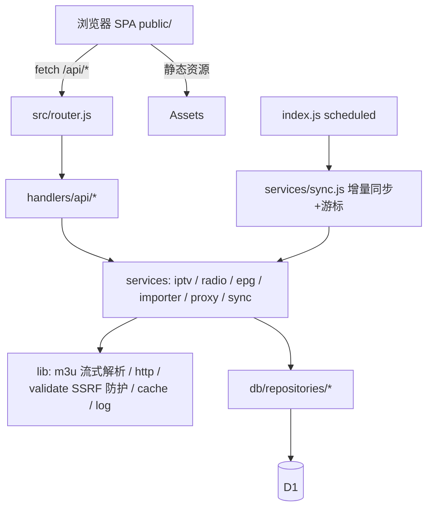

## 产品概述

部署在 Cloudflare Workers 上的一站式「全球 IPTV + 全球广播（FM/AM/SW）」Web 面板。单页应用形式，左侧频道导航、中部频道网格、右侧播放器与节目单，深色科技风，桌面与手机自适应。所有服务端与前端均按职责拆分为独立模块，后续可单独替换数据源、存储层或播放器。

## 核心功能

- **IPTV 频道**：内置 iptv-org 全球列表，按国家/语言/分类浏览，支持 HLS（m3u8）播放
- **广播电台**：内置 radio-browser 全球电台，按 FM / AM / SW（短波）/ 其他 波段分类，音频即点即听
- **自定义订阅**：面板内粘贴 M3U/M3U8 订阅地址或直接粘贴文本导入，支持手动添加单个频道
- **搜索与筛选**：关键词搜索 + 国家、语言、分类、波段组合筛选
- **收藏与最近播放**：一键收藏、历史记录（保留最近 100 条）
- **EPG 电子节目单**：当前频道正在播/即将播出的节目列表，自动缓存
- **流代理**：服务端转发直播流，解决 Referer/防盗链与跨域；支持 Range 续传
- **数据自动更新**：定时拉取内置源并增量入库，断批续跑
- **体验**：深色/浅色主题切换、移动端底部导航与抽屉式筛选

## 边界与约束

- 仅做聚合与播放入口，不内置任何受版权保护的付费内容；自定义频道由用户自行维护
- 全部数据统一存放 D1（频道缓存、收藏、历史、订阅、EPG、任务游标）
- 先本地 `wrangler dev` 自测通过后再部署到 `*.workers.dev`

## 技术栈

- 运行时：Cloudflare Workers（ES Modules，`export default { fetch, scheduled }`），Node 24 仅用于本地工具链
- 存储：Cloudflare D1（含 FTS5 全文索引做搜索）
- 工具链：wrangler 4.155.0（**固定调用方式**：`node "C:\Users\Administrator\AppData\Roaming\npm\node_modules\wrangler\bin\wrangler.js" <cmd>`，shim 损坏勿用）
- 凭据：环境变量 `CLOUDFLARE_API_TOKEN` + `CLOUDFLARE_ACCOUNT_ID`，禁用 `wrangler login`
- 前端：原生 ES Modules（无构建步骤，Worker 静态资源托管）+ hls.js（本地 vendor 化，避免 CDN 依赖）；广播用原生 audio
- 依赖：仅 `wrangler`（dev）、`hls.js`（前端 vendor）

## 实现思路

1. **纯 Worker 单服务**：fetch 处理 API 与静态资源，scheduled（Cron）负责内置源增量同步；无需 Pages/额外后端。
2. **静态资产优先**：`assets.directory = ./public` + `run_worker_first:false`，未命中的请求（`/api/*`）落到 Worker 路由，前端零构建。
3. **入库优先、实时兜底**：iptv-org / radio-browser 数据经解析后写入 D1 `channels`，前端只查 D1；D1 无数据时由 service 层回源拉取并立即落库，保证首次访问即可用。
4. **D1 统一存储**：频道、收藏、历史、订阅、EPG、同步游标全部关系表；搜索用 FTS5 虚表（无结果时回退 LIKE），避免全表扫描。
5. **流式解析 + 断点续跑**：iptv-org 全量 m3u 体积大，Worker CPU/内存受限，`lib/m3u.js` 用流式行解析 + 分批（`CHUNK`）写入，`meta` 表保存 offset 游标，单跑不完下次续跑。

## 架构设计



- 分层：`handlers`（HTTP 出入参）→ `services`（业务）→ `repositories`（SQL）→ D1，单向依赖，便于逐层替换
- `proxy` 独立模块：`http/https` 白名单 + 内网地址拦截（SSRF 防护）+ 可选 Referer/UA 透传 + Range 支持

## 关键实现要点

- **数据同步**：`services/sync.js` 编排；iptv-org 用 `index.m3u` 或分国 m3u，radio-browser 用 `https://de1.api.radio-browser.info/json/stations/search`（需自定义 User-Agent）；波段按 tags/名称启发式判定（shortwave→SW、am→AM、其余默认 FM），可在频道编辑里人工修正
- **EPG**：`https://iptv-org.github.io/epg/guides/{country}/{channel}.epg.xml` 按需抓取，解析后写入 `epg_programs`，TTL 6 小时，失败降级为空节目单
- **性能**：列表接口统一 `LIMIT/OFFSET` + 索引（country_code、kind、band、category）；D1 写入用 `batch()`；代理流用 `ReadableStream` 透传，不缓冲整包；热门列表响应加 `Cache-Control`
- **安全**：代理仅允许 http/https、禁止私有网段与 metadata 地址、`url` 参数长度与协议校验；所有 API 统一错误结构，不回显内部异常细节
- **兼容**：Cron 与 D1 迁移同时对本地（`--local`）与远程（`--remote`）可用；`wrangler.jsonc` 固定 `compatibility_date`

## 目录结构

```
IPTV_RADIO_PROJECTS/
├── package.json                      # [NEW] 依赖与脚本：dev / deploy / d1:local / d1:remote / sync:assets（复制 hls.js 到 public/vendor）
├── wrangler.jsonc                    # [NEW] name、main=src/index.js、compatibility_date、D1 绑定 DB、assets.directory=./public、triggers.crons
├── README.md                         # [NEW] 模块说明、本地/远程部署命令、常见问题
├── src/
│   ├── index.js                      # [NEW] Worker 入口：fetch 委托 router，scheduled 委托 sync
│   ├── config.js                     # [NEW] 环境变量与常量（分页、TTL、内置源 URL、同步批大小）
│   ├── router.js                     # [NEW] 路由表注册与匹配，统一 404/405
│   ├── handlers/api/
│   │   ├── channels.js               # [NEW] 频道列表/详情/搜索/筛选、自定义频道增删改
│   │   ├── radio.js                  # [NEW] 广播专属接口（按波段 band 过滤）
│   │   ├── epg.js                    # [NEW] 节目单查询
│   │   ├── favorites.js              # [NEW] 收藏增删查
│   │   ├── history.js                # [NEW] 播放历史读写与裁剪
│   │   ├── subscriptions.js          # [NEW] 订阅管理（URL/文本导入、启停、手动同步）
│   │   ├── proxy.js                  # [NEW] 流代理入口（校验→services/proxy）
│   │   └── health.js                 # [NEW] 健康检查与同步状态
│   ├── services/
│   │   ├── iptv.js                   # [NEW] iptv-org 抓取、解析、去重入库
│   │   ├── radio.js                  # [NEW] radio-browser 分页抓取与波段判定
│   │   ├── epg.js                    # [NEW] XMLTV 解析与 D1 缓存
│   │   ├── importer.js               # [NEW] 用户 M3U 文本/URL 导入（含频道头信息 logo/group）
│   │   ├── proxy.js                  # [NEW] 上游取流、请求头/Range 透传、错误映射
│   │   └── sync.js                   # [NEW] 定时同步编排：游标续跑、批写入、状态写 meta
│   ├── db/
│   │   ├── index.js                  # [NEW] D1 封装：prepare/batch/事务辅助
│   │   ├── schema.sql                # [NEW] 建表：channels、subscriptions、favorites、history、epg_programs、meta + 索引
│   │   └── repositories/
│   │       ├── channels.js           # [NEW] 频道 CRUD/批量 upsert/筛选查询
│   │       ├── favorites.js          # [NEW] 收藏表访问
│   │       ├── history.js            # [NEW] 历史表访问与裁剪
│   │       ├── epg.js                # [NEW] 节目单读写
│   │       ├── subscriptions.js      # [NEW] 订阅表访问
│   │       └── meta.js               # [NEW] KV 式键值（游标、ETag、上次同步时间）
│   └── lib/
│       ├── http.js                   # [NEW] json/error/响应头与 CORS 统一封装
│       ├── validate.js               # [NEW] URL 协议与 SSRF 校验、参数校验
│       ├── m3u.js                    # [NEW] 流式 M3U/M3U8 解析（#EXTINF 属性解析）
│       ├── xmltv.js                  # [NEW] 轻量 XMLTV 解析
│       ├── cache.js                  # [NEW] 基于 meta 表的 TTL 缓存
│       └── log.js                    # [NEW] 结构化日志（分级、不打印敏感 URL 参数）
└── public/
    ├── index.html                    # [NEW] SPA 骨架
    ├── css/theme.css, layout.css, components.css  # [NEW] 主题变量/布局/组件样式
    ├── js/app.js                     # [NEW] 启动装配
    ├── js/api.js                     # [NEW] 后端接口客户端
    ├── js/state.js                   # [NEW] 轻量状态与本地偏好（主题、最近筛选）
    ├── js/router.js                  # [NEW] hash 路由（iptv/radio/favorites/history/settings）
    ├── js/views/{iptv,radio,favorites,history,settings}.js  # [NEW] 各页面视图
    ├── js/components/{sidebar,channel-list,channel-card,filters,search,player,epg-panel,toast,tabs}.js # [NEW] 可复用 UI 组件
    ├── js/lib/dom.js                 # [NEW] DOM 与事件小工具
    ├── js/lib/hls.js-loader.js       # [NEW] hls.js 懒加载与降级（原生 HLS）
    └── vendor/hls.min.js             # [NEW] 由 npm 包复制而来（sync:assets 脚本）
```

## 关键数据结构

```sql
CREATE TABLE channels (
  id TEXT PRIMARY KEY,            -- kind:source:稳定键
  kind TEXT NOT NULL,             -- 'iptv' | 'radio'
  name TEXT NOT NULL,
  country TEXT, country_code TEXT, language TEXT, category TEXT,
  band TEXT,                      -- 'FM' | 'AM' | 'SW' | NULL
  logo_url TEXT, stream_url TEXT NOT NULL,
  source TEXT NOT NULL,           -- 'iptv-org' | 'radio-browser' | 'custom'
  subscription_id TEXT, is_active INTEGER DEFAULT 1, updated_at INTEGER
);
CREATE INDEX idx_channels_filter ON channels(kind, country_code, category, band);
CREATE VIRTUAL TABLE channels_fts USING fts5(name, category, content='channels', content_rowid='rowid');
```

## 设计风格

深色科技感 + 玻璃拟态：深色星空底、半透明毛玻璃面板、青紫霓虹渐变强调、细微发光边框与悬浮微动效，整体沉稳且高级。

## 页面与区块

1. **IPTV 页（#/iptv）**：顶部导航（Logo/全局搜索/主题切换）→ 左侧国家-分类树形筛选栏 → 中部频道卡片网格（logo、名称、国家、分类、收藏星标）→ 右侧/浮层播放器 + EPG 节目单时间轴 → 底部播放控制条。
2. **广播页（#/radio）**：波段 Tab（FM/AM/SW）→ 国家筛选 → 电台列表（logo、频率标签、音质标签）→ 常驻底部迷你音频播放器（封面、台名、播放/音量）。
3. **收藏页（#/favorites）**：IPTV/广播分组收藏网格，支持取消收藏与直接播放。
4. **最近播放页（#/history）**：按时间倒序列表，一键续播与清空。
5. **设置页（#/settings）**：M3U 订阅管理（新增/启停/立即同步）、手动添加频道、内置源同步状态与手动触发、缓存清理。
移动端：筛选栏收为抽屉，播放器全屏浮层，底部固定 Tab 导航。

## 交互

骨架屏加载、卡片 hover 上浮发光、播放切换淡入、Toast 提示、搜索防抖 300ms、列表无限滚动分页。

## Agent Extensions

### Skill

- **playwright-cli**
- 用途：本地 `wrangler dev` 起来后对面板做冒烟验证（打开首页、点播一个 IPTV/电台、检查接口与控制台报错）
- 预期结果：确认页面可渲染、API 正常返回、播放器无致命 JS 错误